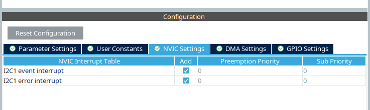

# TMP102 I2C Temperature Driver — STM32L476RG

Interrupt-based I2C driver that reads temperature from a [TMP102](https://www.ti.com/product/TMP102) sensor using an STM32L476RG (Nucleo-64 board).

The whole point of this project was to avoid blocking I2C reads. Instead of the CPU sitting idle during the transfer, `HAL_I2C_Mem_Read_IT` handles everything in the background. When the two bytes show up, an interrupt fires, a callback sets a flag, and the main loop grabs the result on the next pass.

The driver takes care of combining the raw bytes, extracting the 12-bit temperature value, handling negative readings (two's complement), and converting to Celsius.

## Pin Wiring

```
STM32 (Nucleo-L476RG)          TMP102
─────────────────────          ──────
PB6  ──────────────────────►   SCL
PB7  ──────────────────────►   SDA
3.3V ──────────────────────►   V+
GND  ──────────────────────►   GND, ADD0
```

> ADD0 tied to GND gives the default I2C address `0x48` (the HAL needs it shifted: `0x48 << 1 = 0x90`).

## CubeMX Configuration

I2C1 on PB6/PB7, Standard Mode 100 kHz, both event and error interrupts enabled.

<p align="center">
  
  <br><em>PB6 → I2C1_SCL, PB7 → I2C1_SDA</em>
</p>

<p align="center">
  
  <br><em>I2C1 event and error interrupts — both enabled, priority 0</em>
</p>

Clock: HSI → PLL → 80 MHz SYSCLK. PCLK1 also 80 MHz (dividers are 1). CubeMX generated timing register `0x10D19CE4` for 100 kHz at that clock speed.

## Project Layout

```
├── Core/
│   ├── Inc/
│   │   └── tmp102.h              <- address, register, function prototypes
│   └── Src/
│       ├── tmp102.c              <- the driver (read, callbacks, conversion)
│       ├── main.c                <- init + main loop
│       ├── stm32l4xx_it.c        <- I2C1_EV and I2C1_ER interrupt handlers
│       └── stm32l4xx_hal_msp.c   <- GPIO/clock/NVIC init for I2C1
├── Drivers/                      <- HAL library (CubeMX generated)
├── docs/
│   ├── project_report.pdf        <- detailed writeup
│   └── *.jpg / *.png             <- screenshots
├── stm32_tmp102.ioc              <- CubeMX project file
├── STM32L476RGTX_FLASH.ld        <- linker scripts
└── STM32L476RGTX_RAM.ld
```

## Usage

Two functions. That's the whole API.

```c
// kick off a read (returns immediately)
TMP102_ReadTemp_IT(&hi2c1);

// check result (call this in your loop)
float temp_c;
HAL_StatusTypeDef status = TMP102_GetTemperatureC(&temp_c);

// status == HAL_OK    → temp_c has the reading
// status == HAL_BUSY  → transfer still in progress
// status == HAL_ERROR → I2C bus error happened
```

The main loop in `main.c` shows the full pattern — it starts a read, waits for the callback, grabs the value, pauses 250 ms, then starts another one.

## What Happens Internally

1. `TMP102_ReadTemp_IT()` calls `HAL_I2C_Mem_Read_IT` — sends register address `0x00` and reads 2 bytes. Returns right away.
2. I2C peripheral clocks the data in. When done, hardware fires `I2C1_EV_IRQHandler`.
3. HAL processes the interrupt and calls `HAL_I2C_MemRxCpltCallback`, which sets `tmp102_data_ready = 1`.
4. Next time you call `TMP102_GetTemperatureC`, it sees the flag and processes the bytes:

```c
raw = (buffer[0] << 8) | buffer[1];   // combine into 16-bit
raw = raw >> 4;                        // keep upper 12 bits (datasheet pg.8)

if (raw & 0x0800)                      // bit 11 = sign bit
    signed_val = (int32_t)raw - 4096;  // two's complement

celsius = signed_val * 0.0625f;        // 0.0625 °C per LSB
```

**Example:** sensor sends `0x19`, `0x00` → combined `0x1900` → `>> 4` gives 400 → `400 × 0.0625 = 25.0 °C`

**Negative:** sensor sends `0xF6`, `0x00` → combined `0xF600` → `>> 4` gives 3936 → bit 11 set → `3936 - 4096 = -160` → `-160 × 0.0625 = -10.0 °C`

## Building

1. Open in STM32CubeIDE — `File → Open Projects from File System`
2. Build — `Ctrl+B`
3. Should get 0 errors, 0 warnings

<p align="center">
  
  <br><em>Build finished: 0 errors, 0 warnings</em>
</p>

After building you can check the symbols made it into the binary:

```bash
arm-none-eabi-nm -C Debug/*.elf | grep -E 'TMP102|HAL_I2C_Mem|HAL_I2C_Error'
```

<p align="center">
  
  <br><em>All four driver symbols present in flash</em>
</p>

| Address | Function |
|---------|----------|
| `0800061c` | `TMP102_ReadTemp_IT` |
| `0800065c` | `HAL_I2C_MemRxCpltCallback` |
| `08000688` | `HAL_I2C_ErrorCallback` |
| `080006b4` | `TMP102_GetTemperatureC` |

## Current Status

- [x] Driver written and compiling
- [x] Interrupt-based I2C read with callbacks
- [x] Temperature conversion with two's complement
- [x] Successful build — 0 errors, 0 warnings
- [x] Symbol verification — all functions linked into flash
- [ ] Hardware test with a physical TMP102 sensor

The firmware compiles and links fine but a real sensor hasn't been wired up yet. That's the next step.

## References

- [TMP102 Datasheet (SBOS397F)](https://www.ti.com/lit/ds/symlink/tmp102.pdf) — Texas Instruments
- [STM32L476 Reference Manual (RM0351)](https://www.st.com/resource/en/reference_manual/rm0351.pdf) — STMicroelectronics
- [STM32 HAL Manual (UM1884)](https://www.st.com/resource/en/user_manual/um1884.pdf) — STMicroelectronics

---

Built by **Harshil Anuwadia**
