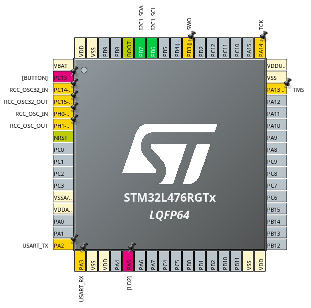
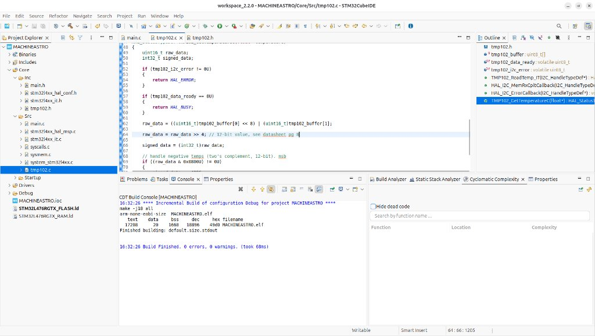
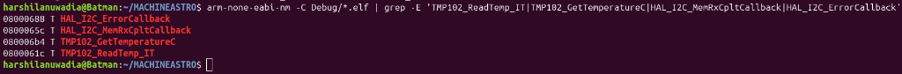

# stm32-tmp102-i2c-driver

This repository contains an interrupt-driven I2C driver that reads temperature from a Texas Instruments TMP102 digital sensor on an STM32L476RG microcontroller.

The driver uses hardware interrupts (`HAL_I2C_Mem_Read_IT`) so the CPU does not stall waiting for sensor bytes over the I2C bus. When the 2-byte temperature packet finishes arriving, an interrupt triggers a completion callback, setting a flag. The main application loop then extracts the 12-bit reading, handles negative values via two's complement sign extension, and calculates the temperature in degrees Celsius.

Tested on an ST NUCLEO-L476RG development board.

## Wiring

Connect the TMP102 breakout to the Nucleo board:

| STM32 Pin | TMP102 Pin | Function |
|---|---|---|
| PB6 | SCL | I2C1 Clock (pulled up) |
| PB7 | SDA | I2C1 Data (pulled up) |
| 3.3V | V+ | Power supply (1.4V to 3.6V) |
| GND | GND | Ground reference |
| GND | ADD0 | Sets I2C 7-bit address to `0x48` |

The STM32 HAL expects 8-bit left-aligned I2C addresses, so `0x48` becomes `0x90` in code (`0x48 << 1`).

## Hardware Configuration

Configured using STM32CubeMX (saved in `stm32_tmp102.ioc`):

- **Pin routing:** PB6 set to `I2C1_SCL`, PB7 set to `I2C1_SDA`, both in Alternate Function Open-Drain mode with internal pull-up (`AF4`).
- **I2C parameters:** Standard Mode (100 kHz), 7-bit addressing, analog noise filter enabled. Timing register is `0x10D19CE4` for an 80 MHz peripheral clock (`PCLK1`).
- **Clock configuration:** 16 MHz internal HSI oscillator multiplied through the PLL to an 80 MHz system clock (`SYSCLK`). AHB, APB1, and APB2 prescalers are all set to 1.
- **NVIC interrupts:** Both `I2C1 event interrupt` and `I2C1 error interrupt` are enabled with preemption priority 0.

<p align="center">
  
  <br>
  <em>Figure 1: STM32CubeMX pin assignment for PB6 and PB7 on the LQFP64 package.</em>
</p>

<p align="center">
  
  <br>
  <em>Figure 2: NVIC interrupt table showing I2C1 event and error interrupts enabled at priority 0.</em>
</p>

## Driver API

The driver interface is defined in `Core/Inc/tmp102.h`:

```c
HAL_StatusTypeDef TMP102_ReadTemp_IT(I2C_HandleTypeDef *hi2c);
HAL_StatusTypeDef TMP102_GetTemperatureC(float *temperature);
```

### 1. Initiate a non-blocking read

`TMP102_ReadTemp_IT()` clears status flags and starts an interrupt-driven memory read from register `0x00`:

```c
HAL_StatusTypeDef TMP102_ReadTemp_IT(I2C_HandleTypeDef *hi2c)
{
    tmp102_data_ready = 0U;
    tmp102_i2c_error = 0U;

    return HAL_I2C_Mem_Read_IT(
        hi2c,
        TMP102_I2C_ADDR,       // 0x90
        TMP102_TEMP_REG,       // 0x00 (Temperature Register)
        I2C_MEMADD_SIZE_8BIT,
        tmp102_buffer,         // 2-byte static reception buffer
        2
    );
}
```

The function returns immediately. The I2C peripheral hardware shifts in data bytes without holding CPU execution.

### 2. Interrupt handling and callbacks

When both bytes are received, the hardware triggers `I2C1_EV_IRQHandler()`, which invokes the HAL interrupt handler. The HAL then calls the application callback implemented in `Core/Src/tmp102.c`:

```c
void HAL_I2C_MemRxCpltCallback(I2C_HandleTypeDef *hi2c)
{
    if (hi2c->Instance == I2C1)
    {
        tmp102_data_ready = 1U;
    }
}

void HAL_I2C_ErrorCallback(I2C_HandleTypeDef *hi2c)
{
    if (hi2c->Instance == I2C1)
    {
        tmp102_i2c_error = 1U;
    }
}
```

### 3. Converting raw data to Celsius

`TMP102_GetTemperatureC()` checks the ready flag, parses the 12-bit data, and applies resolution scaling:

```c
HAL_StatusTypeDef TMP102_GetTemperatureC(float *temperature)
{
    uint16_t raw_data;
    int32_t signed_data;

    if (tmp102_i2c_error != 0U) return HAL_ERROR;
    if (tmp102_data_ready == 0U) return HAL_BUSY;

    // Combine byte 0 (MSB) and byte 1 (LSB)
    raw_data = ((uint16_t)tmp102_buffer[0] << 8) | (uint16_t)tmp102_buffer[1];

    // TMP102 12-bit format stores data left-aligned in bits [15:4]
    raw_data = raw_data >> 4;

    signed_data = (int32_t)raw_data;

    // Sign extend negative values (bit 11 is the sign bit in 12-bit two's complement)
    if ((raw_data & 0x0800U) != 0U)
    {
        signed_data -= 4096;
    }

    // Scale by 0.0625 °C per count (datasheet Table 5)
    *temperature = (float)signed_data * 0.0625f;

    tmp102_data_ready = 0U;
    return HAL_OK;
}
```

### Bitwise operation breakdown

- `<< 8` and `|`: Places the first byte in bits [15:8] and the second byte in bits [7:0].
- `>> 4`: Discards the 4 unused lower bits (extended mode bit and flag bits), aligning the 12-bit temperature count to [11:0].
- `& 0x0800`: Tests bit 11, the most significant bit of the 12-bit integer.
- `-= 4096`: Converts 12-bit two's complement to standard signed 32-bit integer ($2^{12} = 4096$).
- `* 0.0625f`: Multiplies by the TMP102 LSB resolution ($1/16\text{ }^\circ\text{C}$).

**Positive calculation example:**
- Received bytes: `0x19`, `0x00`
- Combined: `0x1900`
- After `>> 4`: `0x0190` (decimal 400)
- Sign bit is 0
- Temperature: $400 \times 0.0625\text{ }^\circ\text{C} = 25.0\text{ }^\circ\text{C}$

**Negative calculation example:**
- Received bytes: `0xF6`, `0x00`
- Combined: `0xF600`
- After `>> 4`: `0x0F60` (decimal 3936)
- Sign bit 11 is set: $3936 - 4096 = -160$
- Temperature: $-160 \times 0.0625\text{ }^\circ\text{C} = -10.0\text{ }^\circ\text{C}$

## Code Layout

The core driver logic lives in two files:
- `Core/Inc/tmp102.h`: Address constants and function prototypes.
- `Core/Src/tmp102.c`: Buffer management, interrupt callbacks, and mathematical conversion.

Application and hardware setup files generated by STM32CubeMX:
- `Core/Src/main.c`: Peripheral initialization and non-blocking polling state machine.
- `Core/Src/stm32l4xx_it.c`: Interrupt service routines (`I2C1_EV_IRQHandler` and `I2C1_ER_IRQHandler`).
- `Core/Src/stm32l4xx_hal_msp.c`: Low-level clock gating, GPIO alternate function setup, and NVIC configuration.

## Build and Verification

### Compilation

Open the repository folder in STM32CubeIDE (`File -> Open Projects from File System`), select the project, and run `Project -> Build Project` (`Ctrl+B`).

The project builds with 0 errors and 0 warnings:

<p align="center">
  
  <br>
  <em>Figure 3: STM32CubeIDE CDT build console output.</em>
</p>

### Symbol Verification

To verify that the driver functions and interrupt callbacks were compiled into the linked executable rather than discarded by dead-code elimination, inspect the ELF file symbols using the GNU ARM toolchain:

```sh
arm-none-eabi-nm -C Debug/MACHINEASTRO.elf | grep -E 'TMP102|HAL_I2C_Mem'
```

<p align="center">
  
  <br>
  <em>Figure 4: Symbol inspection showing driver routines placed in flash text section.</em>
</p>

The linker placed the driver symbols into internal Flash memory (addresses starting with `0x0800`):

| Address | Symbol Type | Function |
|---|---|---|
| `0800061c` | T (Text / Flash) | `TMP102_ReadTemp_IT` |
| `0800065c` | T (Text / Flash) | `HAL_I2C_MemRxCpltCallback` |
| `08000688` | T (Text / Flash) | `HAL_I2C_ErrorCallback` |
| `080006b4` | T (Text / Flash) | `TMP102_GetTemperatureC` |

## Status and Limitations

- **Compilation and linking:** Verified. The firmware builds cleanly in STM32CubeIDE without warnings.
- **Symbol layout:** Verified. Interrupt callbacks and driver conversion code are mapped to Flash memory.
- **Physical sensor bus verification:** Not completed. A physical TMP102 was not attached to the development board during this session, so bus waveforms and live temperature accuracy remain to be tested on hardware with an oscilloscope or logic analyzer.
- **Value readout:** `temperature_c` is maintained in `main.c`. The current build does not route output to a UART virtual COM port or SWO terminal; live value inspection requires a debugger watch expression or memory view.

## Documentation

A full technical writeup covering peripheral registers, clock distribution, and calculations is available in `docs/`:
- [docs/project_report.pdf](docs/project_report.pdf)
- [docs/project_report.docx](docs/project_report.docx)

## References

- [Texas Instruments TMP102 Datasheet (SBOS397F)](https://www.ti.com/lit/ds/symlink/tmp102.pdf)
- [STMicroelectronics STM32L476xx Reference Manual (RM0351)](https://www.st.com/resource/en/reference_manual/rm0351.pdf)
- [STMicroelectronics STM32L4 HAL and LL Drivers User Manual (UM1884)](https://www.st.com/resource/en/user_manual/um1884.pdf)

## License

MIT. See [LICENSE](LICENSE).
